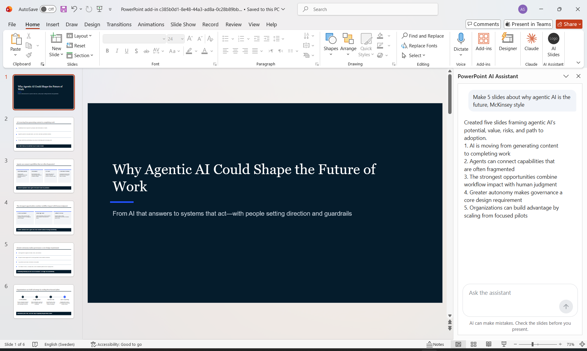

# PowerPoint AI Assistant

A chat panel inside PowerPoint that **creates consulting-style slides from one sentence** and
**edits existing slides in place**. Built as an Office Add-in (Office.js) with a small backend
that keeps the AI key off the user's machine.



## What it does

- **Create:** "Make 5 slides about why agentic AI is the future" gives a cover slide plus content
  slides with action titles (one-sentence insights), a layout picked per slide (key points, columns
  or a numbered process) and a "so what" takeaway bar.
- **Edit:** "Make this slide shorter and sharper" rewrites the text of the selected slide and keeps
  its design. It can also work across the deck ("translate all slides to English").
- **Honest by design:** the AI is told never to invent statistics, sources or quotes, and the add-in
  can only change text boxes it showed the AI.

## How it works

```
PowerPoint task pane (Office.js)
   │  request + the deck's text (which slide is selected)
   ▼
/api/chat backend ── key from .env ──►  LLM (OpenRouter, OpenAI or Azure OpenAI)
   │  JSON: {"action": "create" | "edit", ...}
   ▼
reply.js validates it  →  design.js draws slides / taskpane.js applies edits (PowerPoint API)
```

| File | Role |
|------|------|
| `server/chat.js` | Backend: holds the key, sends the request and deck to the model, rejects other sites |
| `src/taskpane/reply.js` | Turns the model's JSON into a safe create or edit action |
| `src/taskpane/design.js` | Draws the consulting-style layouts with the PowerPoint JavaScript API |
| `src/taskpane/taskpane.js` | Chat UI, reads the deck, applies changes |

## Run it locally

Requires Node.js and PowerPoint (Windows or Mac).

```bash
npm install
cp .env.example .env      # then add your AI_API_KEY
npm start                 # opens PowerPoint with the add-in loaded
```

In PowerPoint: **Home → AI Slides**. Tests: `npm test`.

## Rolling it out in a company

1. Host the built files on HTTPS and point the manifest's URLs there.
2. IT uploads the manifest once in the **Microsoft 365 admin centre → Integrated apps**; the button
   then appears for everyone, with no install.
3. Run `server/chat.js` as an Azure Function in front of the company's **Azure OpenAI**, with
   Microsoft Entra ID single sign-on, so no one handles keys and data stays in the company's Azure.

## Limitations

- Edits replace a text box's whole text, so inline formatting (bold words) is lost.
- No visual redesign of existing slides: PowerPoint's own Designer does that better.
- Layouts assume 16:9 slides.
